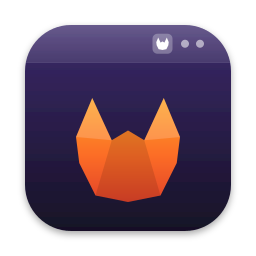
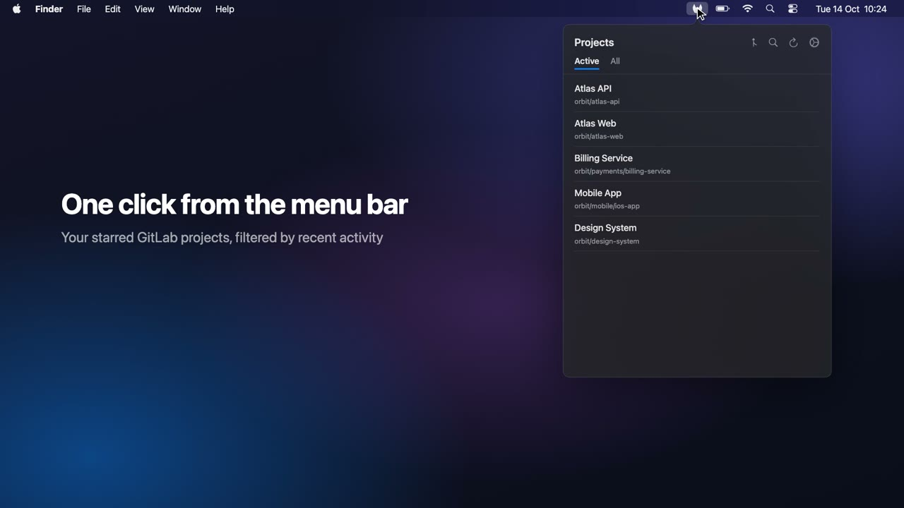
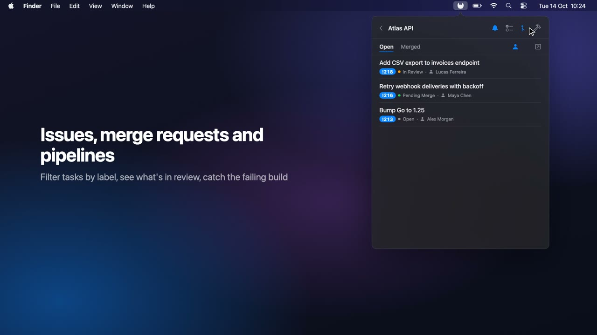
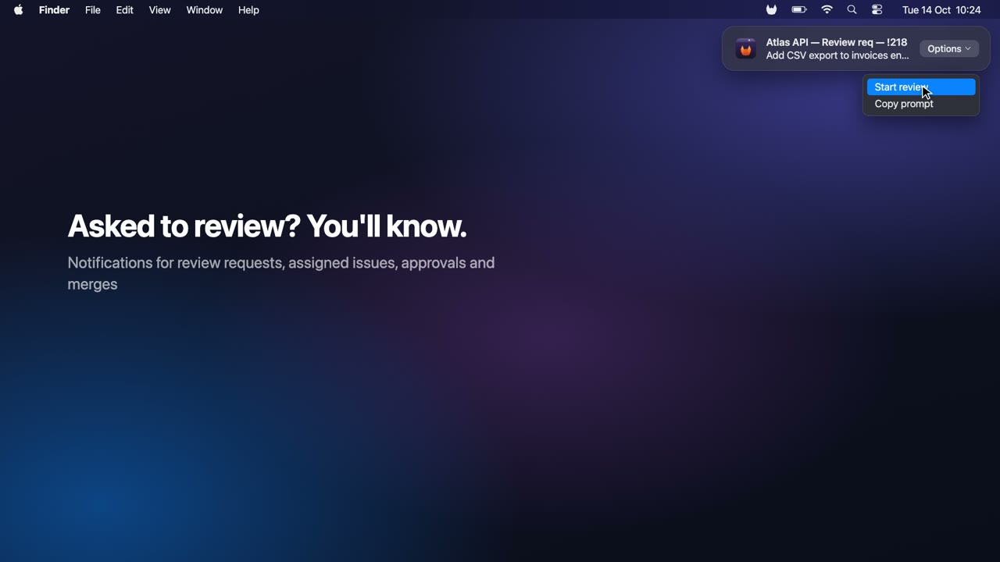
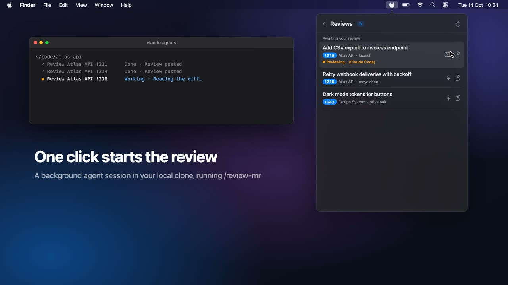
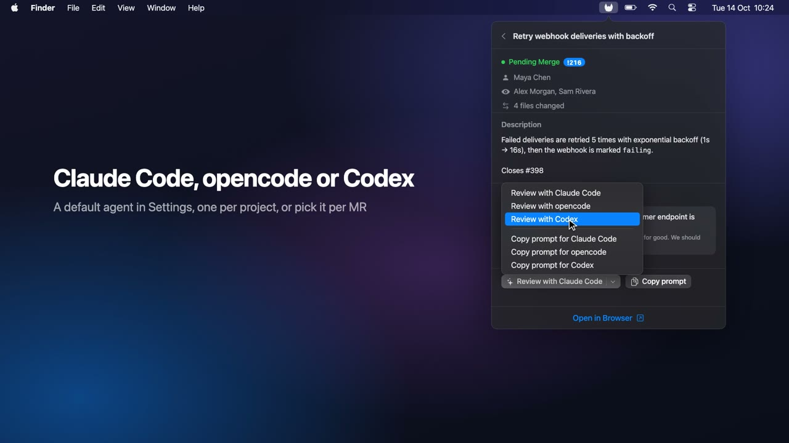
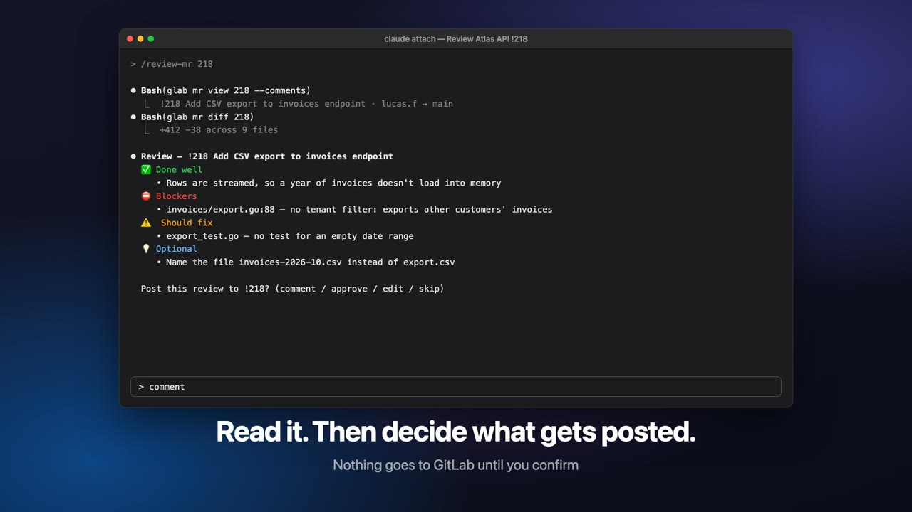
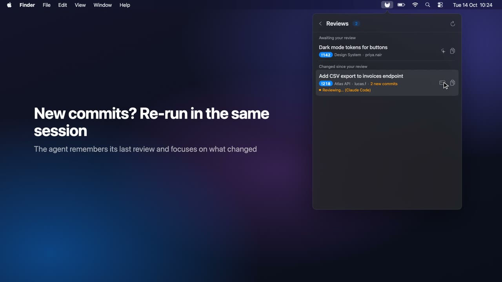
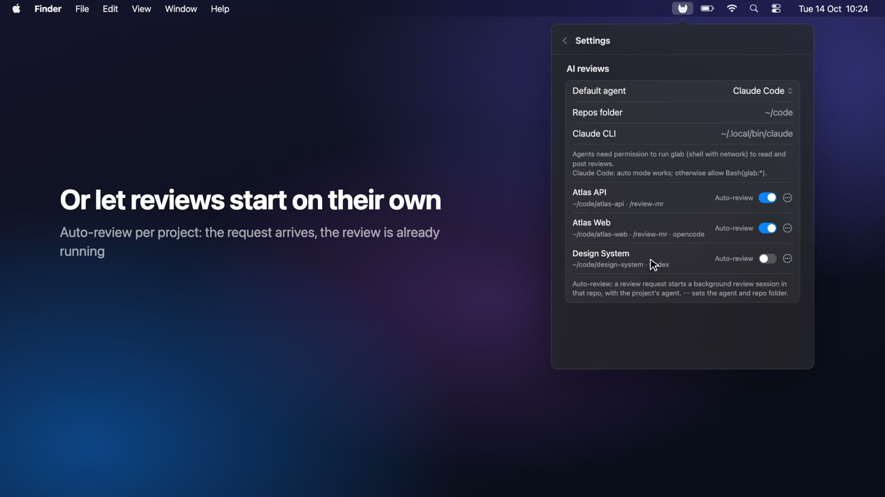

<div align="center">



# GitlabMenubar

**GitLab in your Mac menu bar — with AI code reviews.**

Projects, issues, merge requests, pipelines and review requests, one click away.<br>
Asked to review? Let Claude Code, opencode or Codex start it for you.

[](https://github.com/diogomgbrito/gitlabmenubar/releases/latest)


[](#-install)

[Install](#-install) · [How to use](#-how-to-use) · [Features](#-features) · [AI reviews](#-ai-reviews) · [Development](#%EF%B8%8F-development)


</div>

---

## 📦 Install

Requires **macOS 15 (Sequoia)** or later.

```bash
brew tap diogomgbrito/gitlabmenubar https://github.com/diogomgbrito/gitlabmenubar
brew trust diogomgbrito/gitlabmenubar
brew install --cask gitlab-menubar
```

Update with:

```bash
brew upgrade --cask gitlab-menubar
```

> [!NOTE]
> The app is not notarized by Apple. The Homebrew cask removes the quarantine flag so macOS lets it open. After an upgrade, macOS may ask once for keychain access — choose **Always Allow**.

## 🧭 How to use

### 1. Connect to GitLab

1. In GitLab, go to **Edit profile → Access tokens → Add new token**, tick the **`api`** scope and create the token.
2. Launch the app and enter your GitLab URL (e.g. `https://gitlab.example.com`) and the token. The token is kept in the macOS keychain.

The app lives in the menu bar: **left-click** opens it, **right-click** shows Settings and Quit.

### 2. Star the projects you want to see

> [!IMPORTANT]
> The projects list only shows your **starred** GitLab projects. If the list is empty after connecting, you haven't starred any yet.

Open each project you care about in GitLab and click **Star** at the top right of the project page. Then press **⌘R** in the app to refresh.

- **Active** — starred projects you've had activity in recently. Set the window in **Settings → Projects → Active projects from last**.
- **All** — every starred project.
- **Search** (🔍 or **⌘F**) — finds any project you're a member of, starred or not.

### 3. Browse a project

Click a project to open its tabs:

- **Tasks** — open issues, filtered by label (the app remembers your last label per project).
- **MRs** — open or merged MRs; the person icon narrows to MRs you created or are reviewing. Click an MR for reviewers, linked issues and changes.
- **Pipelines** — recent pipelines and their status.

By default the app opens on the projects list. To pick up where you left off, set **Settings → Projects → Open at** to **Last visited page** (Option-click the icon to start from the projects list).

### 4. Watch projects for notifications and reviews

Click the **🔔 bell** in a project's header (or on an issue) to watch it. Watched projects:

- send notifications for review requests, assigned issues and your own MRs being approved or merged — pick which in **Settings → Notifications**;
- show up in the **Reviews** list (the pull-request icon at the top of the projects list), with the MRs waiting for your review;
- can run AI reviews for you — see [AI reviews](#-ai-reviews).

### ⌨️ Keyboard shortcuts

**⌥⌘G** opens the popover from anywhere (turn it off in **Settings → Keyboard**). Inside the popover:

| Key | Action |
|---|---|
| ⌘1 / ⌘2 / ⌘3 | Tasks / MRs / Pipelines tab of a project |
| ⌘[ or Esc | Back (Esc on the projects list closes the popover) |
| ⌘R | Refresh |
| ⌘O | Open the project tab or MR in the browser |
| ⌘F | Search projects |

## ✨ Features

<table>
  <tr>
    <td width="50%" valign="top">
      
      <h3>🗂️ One click from the menu bar</h3>
      Your starred GitLab projects, filtered by recent activity.
    </td>
    <td width="50%" valign="top">
      
      <h3>🔀 Issues, MRs and pipelines</h3>
      Filter issues by label, see what's in review, check the build. Open an MR for reviewers, linked issues and changes — and re-request a review right from there.
    </td>
  </tr>
  <tr>
    <td width="50%" valign="top">
      
      <h3>🔔 Asked to review? You'll know.</h3>
      Notifications for review requests, assigned issues, approvals and merges on the projects you watch.
    </td>
    <td width="50%" valign="top">
      
      <h3>🤖 One click starts the review</h3>
      A background agent session in your local clone, running <code>/review-mr</code>.
    </td>
  </tr>
  <tr>
    <td width="50%" valign="top">
      
      <h3>🧠 Claude Code, opencode or Codex</h3>
      Default agent in Settings, per project, or per MR.
    </td>
    <td width="50%" valign="top">
      
      <h3>✅ Read it. Then decide what gets posted.</h3>
      Nothing goes to GitLab until you confirm.
    </td>
  </tr>
  <tr>
    <td width="50%" valign="top">
      
      <h3>🔁 New commits? Re-run in the same session</h3>
      The agent remembers its last review and focuses on what changed.
    </td>
    <td width="50%" valign="top">
      
      <h3>⚡ Or let reviews start on their own</h3>
      Auto-review per project: the request arrives, the review is already running.
    </td>
  </tr>
</table>

## 🤖 AI reviews

When you're asked to review an MR, GitlabMenubar can start the review for you in a coding agent: [Claude Code](https://claude.com/claude-code), [opencode](https://opencode.ai) or [Codex](https://developers.openai.com/codex). The review runs in the background in your local clone of the project, and you open the session when it's done.

| Button | What it does |
|---|---|
| **Review with &lt;agent&gt;** | Starts the review. The arrow next to it picks another agent for that MR. |
| **Re-run review** | Appears once the MR has a session: runs the review again **in the same session**, so the agent knows what it reviewed before. |
| **Open session** | Opens it in Terminal (`claude attach`, `opencode -s <id>`, `codex resume <id>`). While the agent is working, the MR shows "Reviewing…". |
| **Copy prompt** | Copies the prompt to paste yourself — `@<repo> /review-mr <iid>` for `claude agents`, the full review prompt for the others. |
| **Auto-review** | Per project, in Settings: starts the review as soon as the review request arrives. |

The buttons are on the Reviews list, the MR detail and the review-request notification.

### Setup — Settings → AI reviews

1. **Default agent**, and per project in the **⋯** menu.
2. **Repos folder**: the folder that holds your local clones (e.g. `~/code`). Each project is matched to its clone by the git `origin` remote; **⋯ → Choose repo folder…** picks one manually.
3. **CLI path** (and model, for opencode/Codex) of the agents you use. Found automatically in the usual install locations and your shell's PATH.
4. Claude only: run `claude` once in each repo and accept the trust prompt — background sessions only start in trusted folders.

### The review command

Repos with `.claude/commands/review-mr.md` use it with every agent:

- **Claude Code** runs `/review-mr <iid>`.
- **opencode** gets a copy in `.opencode/commands/review-mr.md`, **Codex** a skill in `.agents/skills/review-mr/SKILL.md`, so you can re-run it in a resumed session. Copies are git-excluded, refreshed when the Claude command changes, and look up the project from the repo's git remote. Remove the `generated-by` line to keep your own edited version.

Other repos get a generic review prompt that reads the MR with `glab`.

> [!TIP]
> Background runs with opencode and Codex don't post anything to GitLab: you resume the session, read the review and confirm what to post — like `/review-mr` does in Claude.

### Permissions: let the agent run `glab`

Reading the MR and posting the review run `glab`, which needs shell access **with network**. Check your agent's mode:

| Agent | Default | What to do |
|---|---|---|
| Claude Code | `auto` mode — `glab` runs | Nothing. In a stricter mode, allow `Bash(glab:*)`. |
| opencode | Everything allowed, no sandbox — `glab` runs | Nothing, unless your config restricts `shell`: then allow `glab *`. |
| Codex | `workspace-write` sandbox with **network off** — `glab` fails | In `~/.codex/config.toml` set `[sandbox_workspace_write]` → `network_access = true`. On macOS this may not be enough; then start with `--sandbox danger-full-access` (no sandbox — use with care). |

The app's own background Codex runs use a read-only sandbox on purpose: GitlabMenubar fetches the MR with `glab` first and puts it in the prompt, so Codex doesn't need the network until you resume the session to post.

## 🛠️ Development

See [CLAUDE.md](CLAUDE.md) for build commands and architecture, and [RELEASING.md](RELEASING.md) for publishing a new version.
